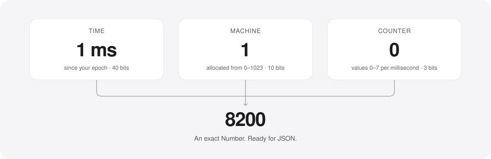

<div align="center">

# Particle 4.0.1

### Every bit. Still a Number.

Exact time-based IDs. The Particle API you know.<br>
JSON by default. Binary when you choose it. Zero runtime dependencies.

**[See the API](#the-api-stays-familiar)** · [Compatibility](#compatibility-before-you-upgrade) · [Measured results](Benchmarks/README.md)

</div>

> **Breaking ID-format change.** Particle 4.0.1 preserves the method names and Number output, with new packing and operating limits. It is available from GitHub Packages as `@sschiau/particle@4.0.1`. The npmjs package `Particle@3.0.3` still uses the old rounded/random format.



<p align="center"><strong>53 exact bits</strong> &nbsp; · &nbsp; <strong>1,024 machine IDs</strong> &nbsp; · &nbsp; <strong>8 IDs/ms per allocation</strong></p>

## The API stays familiar.

Use Node **26 or newer**. Install the [GitHub Packages build](#two-registries-one-implementation), then:

```js
require('@sschiau/particle')
const Particle = globalThis.Particle

Particle.machineId = 1
Particle.epoch = 1480657492000

const id = Particle.generateParticle() // number
const timestamp = Particle.timeFromParticle(id)

console.log(JSON.stringify({ id, timestamp }))
```

CommonJS also returns the same singleton: `const Particle = require('@sschiau/particle')`. From a repository checkout, use `require('./Sources/Particle.js')`. Classic browser scripts still expose `Particle` globally. There is no new generator constructor to adopt.

Each successful call returns an integer from `0` to `Number.MAX_SAFE_INTEGER`. The clock is read with `Date.now()` on every call, and arithmetic rebuilds the time component from that reading. No large-integer type, binary-string assembly, or 32-bit bitwise packing is used.

**Trying it locally:** run `nvm install`, `nvm use`, `npm ci`, and `npm test`. Installing `Particle@3.0.3` from npm gives you the legacy implementation, which does not contain this fix.

## Two registries. One implementation.

The published [GitHub Packages build](https://github.com/sschiau/Particle.js/pkgs/npm/particle) is named `@sschiau/particle@4.0.1` and links to this repository through its package metadata. GitHub Packages requires authentication, including for public npm packages. After [authenticating to GitHub Packages](https://docs.github.com/en/packages/working-with-a-github-packages-registry/working-with-the-npm-registry#authenticating-to-github-packages), install it with:

```sh
npm install @sschiau/particle@4.0.1 --registry=https://npm.pkg.github.com
```

Use `require('@sschiau/particle')` for the original API and `require('@sschiau/particle/binary.js')` for optional binary transport. Publishing this scoped build to GitHub Packages does not publish or update `Particle` on npmjs. The npmjs package remains at v3.0.3 until a separate release is approved.

## Compatibility before you upgrade.

**The interface is familiar; this requires a major-version rollout.** Existing method names and Number output do not make the new identifiers or error behavior a drop-in replacement.

| Area | Compatibility |
| --- | --- |
| `machineId`, `epoch`, `generateParticle()`, `timeFromParticle()` | Names and calling style preserved; generation remains synchronous |
| Number output and machine IDs 0–1023 | Preserved; new outputs are safe integers |
| Node/browser global `Particle` | Preserved; CommonJS return export is added |
| Generated ID format | **Breaking:** 40/10/3 packing replaces the offset/random format |
| Bursts and clock changes | **Breaking:** ninth issuance in a millisecond, rollback, and overflow produce explicit errors |
| Input validation | **Breaking:** numeric strings, fractions, invalid epochs, and unsupported timestamps are rejected |
| Runtime support | **Breaking:** Node 26+; Node 24 support is removed in 4.0.1 |
| `String.prototype.lpad` side effect | **Removed:** callers using it must supply their own formatting |
| Stored legacy IDs | Timestamp decoding is retained with the original epoch; lost integer bits remain unrecoverable |

New IDs can be zero. Keep old records unchanged, update schema/validation assumptions, and record the format and epoch namespace alongside your data. `timeFromParticle()` distinguishes safe 53-bit IDs from the separate large legacy numeric range. New timestamps decode exactly; legacy timestamps remain approximate and can be 1 ms ahead after rounding.

[Read the migration guide →](docs/migration-number53.md)

## A counter. A clear capacity.

| Time | Machine | Counter |
| --- | --- | --- |
| **40 bits** | **10 bits** | **3 bits** |
| About 34.8 years from epoch | Allocated number 0–1023 | Values 0–7 in one millisecond |

```text
id = elapsedMilliseconds × 8192 + machineId × 8 + counter
```

The ninth call for the same machine and epoch in one millisecond throws `ERR_SEQUENCE_EXHAUSTED`. It does not repeat an ID, wait in a loop, or invent future time. Counter state survives configuration switches within the same instance, so switching away and back cannot reset an allocation.

**One allocation is limited to 8,000 IDs/s at most.** Issuing 100,000 distinct IDs needs at least about 12.5 seconds; timer and scheduling delays can make it longer. The measured live run issued **100,000 IDs with zero duplicates in 16.03 seconds**, including application backpressure. Earlier millisecond figures described duplicate-heavy output and do not apply to this format.

## JSON first. Binary optional.

New IDs store exactly in signed 64-bit database integer columns (often named `BIGINT`), without JavaScript BigInt. If a database driver returns integer columns as strings, convert these IDs to Number and validate with `Number.isSafeInteger()`.

They also round-trip exactly as JSON numbers:

```js
const message = JSON.stringify({ id })
const receivedId = JSON.parse(message).id
```

The original API stays focused on IDs. An optional, separate `binary.js` adapter sends batches as explicitly ordered float64 bytes when both ends agree on the format. The GitHub package includes that entry; npmjs v3.0.3 does not provide it.

```js
// Optional adapter; the main Particle export stays unchanged.
const { encodeNumberPayload, decodeNumberPayload } = require('@sschiau/particle/binary.js')
const bytes = encodeNumberPayload([id])
const receivedIds = decodeNumberPayload(bytes)
```

Payload-only medians on the same **100,000 exact IDs**, Node 26.13.1 / Apple M1 Max:

| Format | Encode, copy, decode + validation | Raw bytes |
| --- | ---: | ---: |
| JSON numbers · default | 6.08 ms | 1,700,009 |
| Binary · opt-in | 2.30 ms | 800,008 |

These figures exclude issuance, networks, and databases. Binary does not increase the eight-per-ms generation capacity. [Method and raw results](Benchmarks/README.md) · [Wire contract](Examples/PAYLOADS.md).

```sh
node Examples/payload-roundtrip.cjs          # JSON default
node Examples/payload-roundtrip.cjs --binary # Optional binary
```

Both examples issue 100,000 unique IDs with asynchronous backpressure and take at least about 12.5 seconds.

## Deploy with clear ownership.

1. **Assign each generator its own machine ID.** Concurrent processes/workers in one epoch namespace need different allocations. Fixed deployments can configure these directly.
2. **Share the epoch and format.** Different epochs can produce identical numeric values; they belong to separate namespaces.
3. **Protect restarts.** Recover an allocation's persisted last-issued timestamp and wait until the clock is strictly later before reusing it. Reloading, cloning, or overlapping allocations can collide.
4. **Handle capacity at the application boundary.** Queue or retry after real time advances. Keep database uniqueness constraints as a final guard.

The library retains issuance state in memory for the instance's lifetime. It does not allocate machine IDs, persist restart watermarks, synchronize clocks, or provide global causal ordering. Successful IDs strictly increase within one valid allocation. IDs are predictable identifiers; authorization and secrets need their own mechanisms.

| Error | Application response |
| --- | --- |
| `ERR_SEQUENCE_EXHAUSTED` | Backpressure or retry asynchronously after real time advances |
| `ERR_CLOCK_BEFORE_EPOCH` | Correct the configured epoch or host clock |
| `ERR_CLOCK_ROLLBACK` | Wait for the clock to catch up; keep the current instance |
| `ERR_TIMESTAMP_OVERFLOW` | Plan a new epoch **and namespace** before the range ends |

The API stays synchronous. The [batching example](Examples/generate-batch.cjs) awaits a timer only after exhaustion. Configuration, clock, and capacity failures do not consume a counter slot. In-memory timestamps are correctness state, not cached clock readings used to generate IDs.

## Inspect every claim.

Tests cover all 1,024 machines and eight slots, zero/max safe integers, 100,000 distinct deterministic issuances, failures/recovery, configuration reuse, reentrant clocks, legacy decoding, JSON/binary preservation, malformed frames, and inert DOM rendering. Local checks on Node 26.13.1 report 100% runtime line, branch, and function coverage. Coverage is evidence of testing, not a proof against every defect.

```sh
npm test
npm audit
npm run bench # Live 100,000-ID issuance plus JSON/binary checks; allow ~20 seconds
```

Existing CI workflows, the Node 26.13.1 development pin, and the npm test command remain unchanged. [Contributing](CONTRIBUTING.md) · [Changelog](CHANGELOG.md).

## See the mechanics.

The light static system diagram uses the actual original API and displays the new counter and bit fields. It never patches clocks or randomness.

```sh
python3 -m http.server 8765 --bind 127.0.0.1
# http://127.0.0.1:8765/Demo/mechanics.html
```

[Try the live mechanics demo ↗](https://sschiau.github.io/Particle.js/Demo/mechanics.html). GitHub Pages deploys this demo from `main`.

---

[](https://www.npmjs.com/package/Particle)
[](package.json)
[](LICENSE.md)
[](https://socket.dev/npm/package/Particle)

The npm/Socket badges describe `Particle` on npmjs, where latest remains **v3.0.3**. The exact-Number **4.0.1** implementation is published as [`@sschiau/particle` on GitHub Packages](https://github.com/sschiau/Particle.js/pkgs/npm/particle). Publishing to npmjs requires separate approval; this merge does not publish there or create a release tag.

[Migration](docs/migration-number53.md) · [Code of conduct](CODE_OF_CONDUCT.md) · [Apache-2.0 license](LICENSE.md). Copyright Silviu Schiau.
