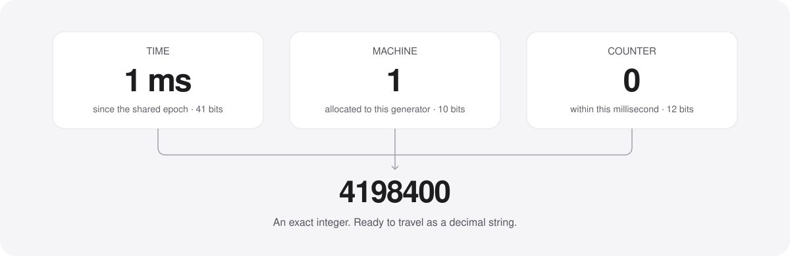

<div align="center">

# Particle.js

### Small IDs. Every bit intact.

Time, a machine number, and a counter.<br>
One exact integer for the events your system creates.

**[Explore the live demo ↗](https://sschiau.github.io/Particle.js/Demo/mechanics.html)** · [Read the API](docs/api.md)

</div>

<br>



<p align="center"><strong>63 exact bits</strong> &nbsp; · &nbsp; <strong>4,096 IDs / millisecond / generator</strong> &nbsp; · &nbsp; <strong>Zero runtime dependencies</strong></p>

<br>

> **Meet the v4 candidate.** This checkout and the live demo use unpublished `4.0.0-rc.1`. npm’s stable release is **3.0.3**, with a different API, ID format, and known precision and random-sequence limitations. [Migrating from v3 →](docs/migration-v4.md)

## An ID in a few lines.

Create a generator once at startup. Give each active generator its own allocated machine number. Keep the resulting ID as a string when it travels through JSON.

```js
import { createGenerator, decode } from 'Particle'

const generator = createGenerator({ machineId: 1 })
const id = generator.nextString()

console.log(JSON.stringify({ id }))
console.log(decode(id).timestamp)
```

CommonJS works too: `const { createGenerator, decode } = require('Particle')`. Both entry points share one implementation, with TypeScript declarations included.

**Try it from source.** Use Node **24.22.1+ in 24.x** or **26.13.1+ in 26.x**. Build this unpublished candidate from a checkout, then install the tarball in your application:

```sh
npm ci --ignore-scripts
npm run check
npm pack
# In your application:
npm install --save-exact /path/to/Particle-4.0.0-rc.1.tgz
```

## Three pieces. One exact value.

| Time | Machine | Counter |
| --- | --- | --- |
| **When it happened.** Milliseconds since a shared starting point. | **Who made it.** An allocated number from 0 to 1023. | **Which one.** Values from 0 to 4095 within the same millisecond. |
| 41 bits | 10 bits | 12 bits |

The result uses **63 value bits**, fitting a non-negative signed 64-bit database integer. `next()` returns `bigint`; `nextString()` returns an exact decimal string. Never convert the full ID to JavaScript `Number`.

The default epoch is **2026-01-01 UTC**. Its time range lasts about **69.7 years**. A custom epoch must also be supplied to `decode(id, { epoch })`. IDs increase strictly within one generator; ordering across machines is not a global causal order. Sort decimal strings numerically.

[Explore the format, bounds, and serialization →](docs/api.md)

## Independent generation. Shared responsibility.

Particle fits systems that need compact, time-based integer IDs and control their infrastructure. For example: orders, event records, and correlation across services.

1. **Agree on the recipe.** Pin the same released version, commit the lockfile, and share a stable epoch and format namespace.
2. **Allocate the numbers.** Each concurrent process or worker needs a different machine ID and one long-lived generator.
3. **Protect restarts.** Before reusing a machine ID, ensure the clock is beyond every timestamp previously issued with that allocation. Persist/recover a watermark or enforce this through your allocator.
4. **Keep the original ID.** Pass it through downstream services. Preserve exact values in storage and database drivers, and enforce uniqueness constraints.

Particle does not allocate machine IDs, persist generator state, or synchronize clocks. Two generators with the same machine ID and epoch can collide. IDs are predictable identifiers; use authorization checks for access and a separate mechanism for secrets.

**Need IDs without machine allocation?** UUIDs may fit better. A database sequence may be simpler when central allocation already suits your application. [Compare the tradeoffs →](docs/comparison.md)

## Clear limits. Explicit errors.

The generator reports capacity and clock problems without spinning or consuming sequence state.

| When this happens | What your application does |
| --- | --- |
| **4,096 IDs in one millisecond** · `ERR_SEQUENCE_EXHAUSTED` | Apply backpressure or retry after the clock advances. |
| **Clock moves backward** · `ERR_CLOCK_ROLLBACK` | Alert and wait for it to catch up. Keep the same generator. |
| **Clock precedes the epoch** · `ERR_CLOCK_BEFORE_EPOCH` | Correct the configuration or clock. |
| **41-bit time range ends** · `ERR_TIMESTAMP_OVERFLOW` | Plan a new epoch and a separate namespace. |

[Read the full error and restart contract →](docs/api.md#uniqueness-and-restart-contract)

## Built to be inspected.

All **13 runtime and demo tests** pass locally on Node 24.22.1 and Node 26.13.1. Full checks include installed CommonJS/ESM consumers, declaration resolution, no-eval execution, and npm audit. Runtime source has 100% line, branch, and function coverage; coverage is evidence of testing, not proof against every defect.

A reproducible burst experiment returns **4,096 distinct v4 IDs** versus **5 distinct v3 Number values**, with the same machine, epoch, and millisecond and idealized legacy random draws. That result describes this specific precision experiment. It is not a speedup or a universal uniqueness guarantee.

[Method and raw results →](docs/benchmarks.md) · [Run the tests →](CONTRIBUTING.md)

The existing GitHub workflows remain unchanged. The proposed Node 24/26 matrix across Linux, Windows, and macOS is separate and has not run.

## See every bit in your browser.

[Open the live system diagram ↗](https://sschiau.github.io/Particle.js/Demo/mechanics.html) or serve this checkout:

```sh
python3 -m http.server 8765 --bind 127.0.0.1
# Open http://127.0.0.1:8765/Demo/mechanics.html
```

A light, static diagram shows the actual candidate at work. Hold the clock to watch the counter change one click at a time. The demo uses local ES modules under a restrictive CSP. Browser integrations need native ES modules and BigInt; import `Sources/Particle.mjs` from a module script. GitHub Pages deploys `main` independently of npm.

---

[](https://www.npmjs.com/package/Particle)
[](LICENSE.md)
[](https://socket.dev/npm/package/Particle)

Badges refer to the published npm package. The v4 candidate remains unpublished.

[Contribute](CONTRIBUTING.md) · [Security](SECURITY.md) · [Code of conduct](CODE_OF_CONDUCT.md) · [Changelog](CHANGELOG.md) · [Release checklist](docs/release-checklist.md)

Apache-2.0 · Copyright Silviu Schiau.
